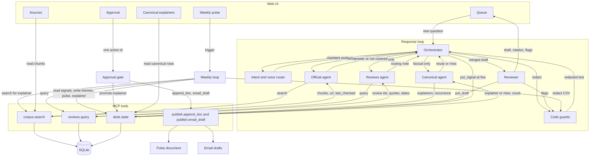
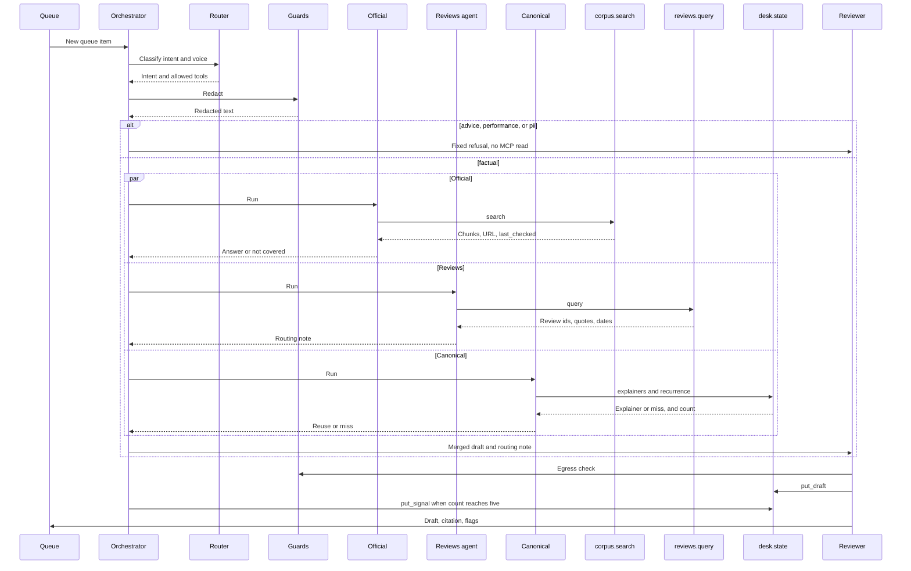

# Support Desk architecture

A deployed web application for Groww support and product. Reviews become themes. User questions become cited, compliance-checked reply drafts. A weekly pulse goes to the product team. A human approves every write.

This document is the design for that system. It joins three earlier milestones into one scheduled application: a cited FAQ corpus (Milestone 1), review clustering with a weekly pulse, fee explainer, and approval-gated MCP workflow (Milestone 2), and a three-agent response desk with a reviewer (Milestone 3).

**Product:** [Groww on the Play Store](https://play.google.com/store/apps/details?id=com.nextbillion.groww&hl=en_IN)

## What the system is for

Support and product each hold half of the same picture. Support rewrites the same fee answer many times a month and sometimes gets it wrong. Product sees that "pricing confusion is up" and cannot see which fee, or what support has been telling people.

The system holds the missing connective tissue in one place:

| Source | Question it answers | What a claim must point at |
| --- | --- | --- |
| Official corpus | What do the twelve Groww pages below actually say? | One URL from that list |
| Reviews | What are users confused about in the week's Play Store file, and which reviews say so? | A `review_id` from that file, plus that Monday–Sunday window |
| Support desk | How often is this question arriving, and which approved answer do we already use? | Canonical explainer id, or a weekly recurrence count |

A reply, a pulse, or an explainer is valid only when every factual claim traces to one of those three. When none of them covers the question, the system says so and names which of the twelve pages it searched.

## Sources

Two inputs stay closed. The corpus is twelve public Groww URLs. The reviews for a week are one CSV, written by the Sunday job. Agents search those stores. They do not fetch a new URL at answer time.

### Official corpus

The corpus is only these pages. A fetch stores each page. It does not follow links from the help hubs, the pricing page, or the scheme pages. A citation URL has to be one of these, character for character.

| # | Page | What it is allowed to support |
| --- | --- | --- |
| 1 | [Pricing](https://groww.in/pricing) | The charge names and amounts this page states. The fee lexicon is built from this text. |
| 2 | [Help](https://groww.in/help) | Sentences that appear on the help hub itself. |
| 3 | [Mutual fund help](https://groww.in/help/mutual-funds) | Sentences that appear on this hub. |
| 4 | [Payments help](https://groww.in/help/payments) | Sentences that appear on this hub. |
| 5 | [When are DP charges levied?](https://groww.in/help/stocks,-f&o,-ipo-&-mtf/searchable/when-are-dp-charges-levied) | When a DP charge applies: a scrip debited from the demat account, priced per sell transaction, as depository charges, Groww charges, and GST. The rupee amounts live in the chunk, with `last_checked`. |
| 6 | [How do I withdraw money?](https://groww.in/help/my-account/payments/how-do-i-withdraw-money-from-my-groww-account-2) | The withdrawal steps this article states. |
| 7 | [Where can I see my demat account number?](https://groww.in/help/stocks,-f&o,-ipo-&-mtf/sx-demat-account/where-can-i-see-my-demat-account-number) | Where the app shows the demat number (BOID) and DP ID. A reply may repeat those navigation steps. It never asks for or stores someone's number. |
| 8 | [SBI Large Cap Direct Growth](https://groww.in/mutual-funds/sbi-large-cap-direct-plan-growth) | Non-performance facts on this scheme page. |
| 9 | [SBI Flexicap Direct Growth](https://groww.in/mutual-funds/sbi-flexicap-fund-direct-growth) | Non-performance facts on this scheme page. |
| 10 | [SBI ELSS Tax Saver Direct Growth](https://groww.in/mutual-funds/sbi-elss-tax-saver-fund-direct-growth) | Non-performance facts on this scheme page. |
| 11 | [SBI Contra Direct Growth](https://groww.in/mutual-funds/sbi-contra-fund-direct-growth) | Non-performance facts on this scheme page. |
| 12 | [SBI Small Midcap Direct Growth](https://groww.in/mutual-funds/sbi-small-midcap-fund-direct-growth) | Non-performance facts on this scheme page. |

Each stored chunk has `chunk_id`, `url`, `title`, `text`, and `last_checked` (the date that page was fetched). `corpus.search` returns chunks from this table only.

Before a scheme-page chunk is searchable, return, CAGR, NAV, and other performance figures are removed from its text. Category, plan name, expense ratio, and exit load stay, because those are facts about the scheme rather than a performance figure. A question that asks for a return or a comparison among these five funds is the `performance` or `advice` intent, and the reply is the fixed refusal even though the page sits in the corpus.

The closed topic list is derived from this table at build time:

| Topic id | Assigned when |
| --- | --- |
| `fees.dp` | The text is about DP charges. The DP article is the primary page. The pricing page is a second page only when its own text states the DP charge. |
| `fees.<charge>` | One id per other charge name that the pricing page actually uses, such as the brokerage or statutory names printed there. The id is created from that page, not from a handwritten list. |
| `payments.withdraw` | Withdrawal questions. Pages 4 and 6. |
| `account.demat` | Where to see the demat number or DP ID. Page 7. |
| `mutual_funds.help` | Mutual-fund help that is not one of the five schemes. Page 3. |
| `scheme.sbi_large_cap` | Page 8. |
| `scheme.sbi_flexicap` | Page 9. |
| `scheme.sbi_elss` | Page 10. |
| `scheme.sbi_contra` | Page 11. |
| `scheme.sbi_small_midcap` | Page 12. |
| `topic.unknown` | Nothing in the list matches. This id is stored on the queue item. It does not create a five-times pulse signal. |

### Reviews

The scheduled week does not read the checked-in sample. Every Sunday at 22:30 on the `+08:00` clock (14:30 UTC), GitHub Actions fetches the Groww Play Store listing `com.nextbillion.groww` for the India English feed. The window is Monday 00:00:00 through Sunday 23:59:59 on that clock: the Monday six days before that Sunday, through the Sunday night the job runs. A run on Monday morning uses that same finished week. The job writes `data/Playstore_<fromdate_todate>.csv`, for example `data/Playstore_2026-11-09_2026-11-15.csv`, with the same columns as the sample file.

`data/playstore.csv` stays the local sample: the English India feed of 1,340 reviews whose `created_at` runs from `2026-11-01T00:09:09+08:00` through `2026-11-11T11:29:18+08:00`. Tests and a manual weekly run without a fetched file use that range. `created_at_ist` is the same instant in IST. It is not a second window. The sample had no row dated 12 November 2026 when it was collected.

| CSV column | Working store |
| --- | --- |
| `review_id` | Kept. Themes and quotes cite this id. |
| `created_at` | Kept. This clock defines the window. |
| `content` | Kept after the PII redactor runs. Pulse quotes come from this column. |
| `score` | Kept as metadata. A star rating is not a fee fact. |
| `created_at_ist`, `thumbs_up`, `app_version` | Kept as metadata beside the review. |
| `user_name` | Left in the CSV. Not copied into SQLite, the interface, logs, or agent state. |
| `developer_reply`, `developer_replied_at` | Left in the CSV. A Play Store reply is not a corpus page and is not quoted in the pulse. |

## Lines the design draws

These boundaries are enforced in code. Prompts repeat them. Prompts are not the control.

1. **Facts only.** The user-facing voice states what an official page says. It does not recommend, rank, or tell anyone to buy or sell. It does not state returns or performance.
2. **The model does not mint evidence.** A source link in a draft must be a URL returned by the corpus tool for that run. A review id in a theme must be an id returned by the reviews tool for that window. A failed check becomes a reviewer flag, and the draft cannot be approved until the flag is cleared or the human rejects the draft.
3. **One approval, one action.** Approving a pulse append does not approve the email draft, the explainer, or any reply. The executor runs the single action whose id and payload hash the human approved.
4. **Reuse beats redrafting.** An approved fee explainer is the canonical answer for that fee. The response loop serves it instead of writing a fresh draft.
5. **Five repeats become a recurring support signal.** The same question five times in a week is one signal in the weekly pulse: the count, the window, and a confusion summary. When that question is a fee, the fee confusion analysis is a part of the same signal, and the explainer is drafted from that analysis. The response loop records the signal. It does not email product on its own.
6. **PII stops at the door.** PAN, account numbers, and phone numbers are redacted before a question, review, log line, or agent message is stored. Agent state keeps the redacted text and a hash, never the raw value.
7. **The weekly loop runs through once it starts.** Triggering it ingests, clusters, drafts the pulse, and drafts the explainer with no further manual steps. Humans meet the result on the approval screen.

## System shape

One service. A worker runs the weekly loop on a schedule and on demand. Agents reach data and side effects only through MCP tools. Write tools check an approval record before they act.

### Stack

| Piece | Choice | Why |
| --- | --- | --- |
| Service | Python 3.12, FastAPI | Agents, MCP, eval diffs, and the weekly job live in one process |
| UI | Server-rendered pages | Queue, pulse, sources, approval, and explainers ship with the API |
| State | SQLite | Evals snapshot the file and diff it after an edit, approval, or rejection |
| Tools | MCP Python SDK | Corpus, reviews, desk, and publish are the only tool surface |
| Schedule | In-process weekly job | One trigger runs the weekly loop to the approval queue |
| Model | One chat model behind a thin client | Guards and citations do not depend on which provider is configured |
| Corpus file | Chunks built from the twelve URLs above | Search reads the chunk table, not the live web |
| Reviews file | `data/playstore.csv` | The weekly job ingests this path |

Third-party blogs and app back-end screenshots are out of the source list. So is any Groww URL that is not one of the twelve.

## Intent and voice

Intent is decided before any agent writes a reply. The router uses a closed label set. The label picks the voice and which tools are allowed to run.

| Intent | How it is recognized | User-facing voice | Tools allowed |
| --- | --- | --- | --- |
| `factual` | A question the twelve-page corpus or a canonical explainer can answer, including a named SBI scheme's non-performance facts | At most three sentences, one corpus link | Corpus, canonical explainers, review counts for the routing note |
| `not_covered` | Retrieval returns no chunk from the twelve pages that supports the question | Says it is not covered and names the queries and the page titles searched | Corpus search only, so the refusal can name the search |
| `advice` | Buy, sell, hold, "should I", "which of these funds", portfolio advice | Fixed refusal. No product recommendation | None for the reply body |
| `performance` | Returns, CAGR, NAV, profit, "how much will I make", including when the figure sits on one of the five scheme pages | Fixed refusal. No figures | None for the reply body |
| `pii` | PAN, account number, or phone number | Fixed refusal after redaction | None. The raw text is never stored |

`advice`, `performance`, and `pii` use fixed templates stored in code. The model does not paraphrase them. A rephrased or repeated attempt hits the same template.

The internal routing note is a separate field. It can mention theme, review ids, and whether a canonical explainer was reused. It is never copied into the user-facing draft.

## Code guards

Guards run on the way in and on the way out of every model call.

**Ingress**

- Replace PAN (`[A-Z]{5}[0-9]{4}[A-Z]`), Indian phone numbers, and long digit account or demat numbers with typed placeholders (`[PAN]`, `[PHONE]`, `[ACCOUNT]`).
- Persist the redacted text. Drop the raw body.
- On review ingest, apply the same redactor to `content` and drop `user_name` before the row is written.
- Log the event id, intent, and tool names. Omit question text when the intent is `pii`.

**Egress**

- Reject a draft that contains buy/sell language, a recommendation, or a performance figure. The reviewer flag is `scope`.
- Reject a draft whose source link is not in the tool results for that run. The reviewer flag is `ungrounded`.
- Reject a draft over three sentences, a pulse over 250 words, or an explainer over six bullets. The reviewer flag is `length`.
- Require a `last_checked` date on every explainer, copied from the corpus chunks used.

A guard failure still leaves a queue item. The item's outcome is a refusal, a not-covered reply, or a flagged draft. The queue never sits without an outcome.

## Response loop

The orchestrator is the entry of the response loop. Each incoming question becomes one queue item and is handed to the orchestrator. The orchestrator calls the intent and voice router and the guards, then the three agents in parallel, then the reviewer.

### Orchestrator

The orchestrator runs first. Nothing else in the response loop starts itself.

1. Call the intent and voice router. The router returns the intent and the voice. No MCP call. The label decides which tools later steps may use.
2. Call the guards to redact the question. No MCP call. For `advice`, `performance`, or `pii`, the fixed template is the whole reply. The agents are not called, and `corpus.search`, `reviews.query`, and `desk.state` are not called for the reply body.
3. For a factual question, call the three agents in parallel. Each agent calls one MCP tool and returns that result to the orchestrator.
   - Official agent calls `corpus.search`. The orchestrator reads the chunks, the URL, and `last_checked`.
   - Reviews agent calls `reviews.query`. The orchestrator reads the review ids, quotes, and dates, and keeps them for the routing note.
   - Canonical agent calls `desk.state` for `explainers` and `recurrence`. The orchestrator reads the approved explainer or a miss, and the count.
4. Merge in this order. A canonical hit becomes the reply, trimmed to three sentences, with `reused_explainer_id`. Otherwise the grounded official answer and its one source link. Otherwise `not_covered`, including the queries sent to `corpus.search`.
5. Attach the routing note: theme, review ids, window, recurrence count, and whether an explainer was reused.
6. Hand the draft to the reviewer. The reviewer calls the guards for the egress check, then calls `desk.state` `put_draft`. The queue reads the stored draft, citation, and flags.
7. When the count for a real topic reaches five, the orchestrator calls `desk.state` `put_signal`. The weekly loop is the reader of that signal. `publish` is not called.

### The three agents

They run in parallel. None of them sees the others' output. Each may call only the MCP tools in its column.

| Agent | Source | Produces | Forbidden |
| --- | --- | --- | --- |
| Official | `corpus.search` | A candidate answer with one source link, or `not_covered` plus the queries it ran | Review text, prior replies, invented URLs |
| Reviews | `reviews.query` | Matching review ids, quotes, theme label, window | A user-facing fact about fees or product rules |
| Canonical | `desk.explainers` and `desk.recurrence` | The approved explainer to reuse, or a miss, plus this week's count for the question key | A newly written fee answer |

The orchestrator is the only caller of these agents. Each agent calls its own MCP tool and returns the result to the orchestrator.

### Reviewer

The reviewer checks the orchestrator's draft against the egress guards and the tool trace. It may flag. It may not add a fact, a link, or a number. Flags show on the queue row.

### Human actions on a draft

| Action | State change |
| --- | --- |
| Edit | Replaces the body of that draft only. Citation, sibling drafts, pulse, and explainers stay as they were. |
| Approve | Marks that draft approved. No other action runs. |
| Reject | Marks that draft rejected. The rest of the queue is unchanged. |

Every action writes an audit row: item id, action, actor, timestamp, and a hash of the draft before and after. Evals diff the database around each action.

### Recurrence

A question key is `(intent, topic)`. `topic` is one of the ids in the corpus table above. `topic.unknown` is recorded and is not eligible for a pulse signal. The count for a real topic increments inside the review window for this file, 1–11 November 2026 on the `created_at` clock, when the demo is run against `data/playstore.csv`. A live week uses the Monday–Sunday window that contains the question. At five, the loop writes one recurring support signal and waits. It does not publish anything.

A recurring support signal is the unit that shows up in the pulse. It carries:

| Field | What it holds |
| --- | --- |
| Topic id | The corpus topic, such as `fees.dp` |
| Count | How many queue items share that key in the window |
| Window | The range the count covers |
| Queue item ids | The redacted questions behind the count |
| Confusion summary | What those questions are confused about, in two sentences or fewer |
| Fee confusion analysis | Present only when the topic is `fees.dp` or another `fees.<charge>` id. This analysis is part of the signal, not a second object beside it. |

The confusion summary says which topic the questions concern and what people keep asking. It is written from the redacted text of the queue items. It contains no recommendation, no return or performance figure, and no PII. A later question in the same window updates the count, the item ids, the summary, and, when present, the fee confusion analysis together. A signal with no summary is incomplete and is not rendered.

### Fee confusion analysis

This is the "which fee, and what is unclear about it" part of a recurring support signal. It exists only inside a signal whose topic is a fee. A review theme can share that topic and supply quotes. The theme does not own a separate fee-confusion record.

| Field | What it holds |
| --- | --- |
| Fee topic | The signal's `fees.*` id, named with the charge words from the pricing page or the DP article |
| What is confused | The signal's confusion summary, plus the matching review quotes when a theme has the same topic id |
| Review evidence | Review ids, quotes, and the same window. Empty when no theme shares the topic. Every id is one the reviews tool returned. |
| Corpus pages | The chunk URLs that support the explainer. For DP charges those are the DP article and, when its text states the charge, the pricing page. |
| Explainer | Six bullets or fewer, facts only, two of those URLs, `last_checked` copied from the chunks. Drafted from this analysis. |

The analysis describes the confusion. The explainer states the official answer. A fee signal with no fee confusion analysis is incomplete. A non-fee signal, such as a withdrawal or demat question, has a confusion summary and no fee confusion analysis.

## Weekly loop

GitHub Actions starts the week on Sunday night and runs the steps below in this order. The job stops on the approval screen. Nothing is published.

1. Fetch Play Store reviews and write `data/Playstore_<fromdate_todate>.csv` for Monday through Sunday. The file still holds `user_name` and both developer-reply columns.
2. Filter that file while reading it. Drop a review with fewer than eight words. Drop a review that is not English, including Hindi or Bengali written in Latin letters and any text in another script. Redact PII in `content`. Insert `review_id`, redacted content, `created_at`, and `score`. Do not copy `user_name` or a developer reply into SQLite.
3. Set the pulse window to that Monday 00:00:00 through Sunday 23:59:59. A manual run on `data/playstore.csv` keeps the sample range, `2026-11-01T00:09:09+08:00` through `2026-11-11T11:29:18+08:00`.
4. Cluster into at most five themes. Rank them. Keep the top three for the pulse. Label each theme with a corpus topic id when the quotes match one. Themes stay review clusters. They are not a separate fee-confusion list.
5. Attach review ids and that window to every theme. A theme without ids is invalid and is not published. Quotes are spans of `content`.
6. Read recurring support signals whose window overlaps this range. Keep each real topic that reached five, with its confusion summary. Ignore `topic.unknown`. A signal with no summary is a failed link.
7. For each kept signal whose topic is a fee, write the fee confusion analysis onto that signal. Attach the review theme with the same topic id as its review evidence. Draft the explainer from that analysis: six bullets or fewer, two corpus links, `last_checked` from those chunks. Both chunks have to support the bullets. A missing second supporting page leaves the explainer flagged `ungrounded`. A fee theme with no recurring support signal stays in the pulse as a theme and does not open an explainer.
8. Draft the weekly pulse: 250 words or fewer, supporting quotes, three action ideas, theme counts with the window written next to each count. The recurring-support-signals block is copied from the signal rows, fee confusion analysis included, so the word cap cannot drop it or rewrite it.
9. Open the approval actions, each with its own payload and destination: the pulse document, the email draft, and the explainer when a fee signal exists. The job ends.

Clustering is deterministic given the same model settings and the same input file: the job stores the model id, the window, and the input hash on the pulse row.

## How the loops connect

Two writes cross the boundary. Both are data, not implicit side effects.

The join key on both crossings is a corpus topic id (`fees.dp`, another `fees.<charge>` id from the pricing page, or one of the other ids in the source table). A review theme meets a recurring support signal only when they carry the same id, and then the theme's quotes sit inside that signal's fee confusion analysis.

**Response → weekly.** Five occurrences of one real topic inside the pulse window create one recurring support signal. For this CSV that window is the `created_at` range above. The weekly job prints that signal in the pulse, and prints the fee confusion analysis inside it when the topic is a fee. A pulse that omits the signal, the confusion summary, or a required fee confusion analysis fails the feasibility check.

**Weekly → response.** When a human approves the explainer on that fee confusion analysis, the explainer becomes `canonical` for the signal's fee topic. The canonical agent reads only rows in that status. Later questions with the same topic id reuse it. The queue shows the explainer id on those drafts. The DP article and the pricing page are the pages that explainer is allowed to cite.

The response loop never appends the pulse document. The weekly loop never approves a reply.

## Approval gate

The gate is the only path to a side effect. MCP publish tools call it. Agents do not.

An approval action stores:

- `action_id`
- `kind`: `append_doc` or `email_draft` (weekly), or `accept_reply` (response)
- `destination`: document id and section, or the draft mailbox
- `payload`: the exact text that will be written
- `payload_hash`
- `status`: `pending`, `approved`, `rejected`, `executed`

The approval screen lists kind, destination, and the full payload before anything is written.

Execution rules:

- The executor loads one `action_id`.
- Status must be `approved`, and the hash must match the payload about to be written.
- `append_doc` appends that payload to the pulse document.
- `email_draft` creates an email draft with that payload. Sending mail is not a tool.
- `accept_reply` marks the reply approved for the queue. It does not send.
- A second execution of the same `action_id` is a no-op recorded in the audit log.
- Rejecting an action leaves every other pending action waiting.

Approving the pulse and approving the explainer are two actions. The explainer becomes canonical only on its own approval.

## MCP boundary

| Server | Tools | Who may call them |
| --- | --- | --- |
| `corpus` | `search(query) → chunks{id, url, title, text, last_checked}` from the twelve pages only | Official agent, sources panel |
| `reviews` | `query(window, theme?) → reviews{id, quote, date}` | Reviews agent, weekly loop |
| `desk` | `explainers(topic)`, `recurrence(key, window)`, `put_signal(topic, count, window, item_ids, confusion_summary, fee_confusion_analysis?)`, `put_draft` | Canonical agent, both loops |
| `publish` | `append_doc(action_id)`, `email_draft(action_id)` | Approval executor only |

`publish` returns an error when the action is missing, still pending, rejected, or already executed, and when the hash differs. There is no unauthenticated write tool and no send tool.

Read tools return ids and URLs from the stores. They do not accept a URL from the model and fetch it.

## Data model

SQLite tables, all free of raw PII:

| Table | Holds |
| --- | --- |
| `corpus_chunks` | Text from one of the twelve URLs, that URL, title, topic id, `last_checked` |
| `reviews` | `review_id`, redacted `content`, `created_at`, `score`, source file hash. No `user_name`, no developer reply |
| `queue_items` | Redacted question, intent, topic, status |
| `drafts` | Reply, citation URL, routing note, flags, `reused_explainer_id`, hashes |
| `recurrence` | One recurring support signal: question key, window, count, item ids, confusion summary, and the fee confusion analysis when the topic is a fee |
| `themes` | Label, review ids, window, rank, topic id. Review evidence for a fee analysis, not a fee analysis of its own |
| `pulses` | Body, word count, window, input hash, status. The recurring-support-signals block is stored with the body |
| `explainers` | Bullets, two URLs, `last_checked`, topic, status, and the signal id whose fee confusion analysis produced it |
| `approval_actions` | Kind, destination, payload, hash, status |
| `audit_log` | Entity id, action, before hash, after hash, timestamp |

Logs and agent transcripts live in `audit_log` and a redacted trace file. Both run through the same redactor as ingress.

## Interface

| View | Reads | What the operator can do |
| --- | --- | --- |
| Queue | `queue_items`, `drafts` | Open a draft, edit it, approve it, reject it. See citation and reviewer flags |
| Weekly pulse | `pulses`, `themes`, `recurrence` | Read themes, quotes, and counts. Read each recurring support signal, including the fee confusion analysis inside a fee signal |
| Sources | `corpus_chunks`, draft citations, explainer URLs | See the page behind a claim and its `last_checked` date |
| Approval | `approval_actions` | Read the exact payload and destination, then approve or reject that action |
| Canonical explainers | `explainers` where status is `canonical` | See the fee answers the response loop is reusing, with both source links |

## Evaluations

Evals run against the assembled service and a fixture database. They snapshot SQLite before and after each case.

**Feasibility.** Every fixture question ends as a draft or an explicit not-covered reply. Every theme has review ids and a window. The pulse is ≤ 250 words and the explainer is ≤ 6 bullets. Triggering the weekly job produces both approval actions with no manual step in between.

**Correctness of edits.** Edit one draft and diff the database: only that draft body changes. Approve one action and diff: only that action's status changes, and only its sink is written. Reject one draft and diff: the other queue rows match the snapshot.

**Grounding and compliance.** Fifteen claims drawn from replies, the pulse, and the explainer each resolve to a corpus URL or a review id. Questions outside the corpus get a not-covered reply that names the search. Advice requests, return-figure requests, and messages containing a PAN, an account number, and a phone number — rephrased and repeated, in both loops — each end as a refusal or a redacted record. A scan of the database, logs, and traces finds none of the raw sensitive values.

## Deployment

The prototype is one hosted process: FastAPI serves the five views and the API. The weekly fetch is a GitHub Action, `.github/workflows/weekly-playstore.yml`. Its cron is `30 14 * * 0`, Sunday 14:30 UTC, which is Sunday 22:30 at `+08:00`. `workflow_dispatch` runs the same job by hand. The command is `python -m desk.schedule`. It fetches the week, writes the CSV, filters, and runs the weekly steps. The new CSV is committed under `data/`. The job database is uploaded as an artifact.

Configuration is environment variables: model credentials, the path to the built corpus, the pulse document destination, and the draft mailbox destination. The corpus build fetches the twelve URLs once and writes `corpus_chunks` with `last_checked`. When the job database has no chunks, it loads `fixtures/pages` so the explainer search has the sample pricing page and the DP article.

A local run and the hosted run use the same entry point. Evals use a temporary SQLite file and a fixture corpus so they do not touch the hosted document or mailbox. The checked-in `data/playstore.csv` is the sample for those runs, not the file the Sunday job writes.

## Out of scope

- Logging into Groww, or calling any private API.
- Following links beyond the twelve corpus URLs.
- Sending email. The system creates a draft a human already approved.
- Storing account identifiers, demat numbers, or Play Store display names.
- Citing a developer reply, a star rating, or any URL outside the twelve pages.
- Putting a return, CAGR, or NAV from a scheme page into a reply, a pulse, or an explainer.
- Letting the weekly loop or the response loop publish without its own approval action.
